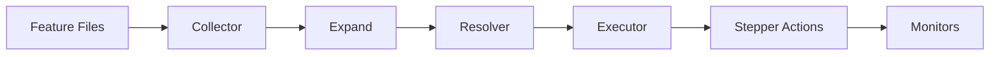

# Haibun Architecture: The Journey of a Feature Line

This document explains how Haibun processes feature files, grounded in a practical example: logging into a site, verifying all requests stay within allowed domains, and checking that the requests don't return 4xx/5xx or take longer than 5 seconds.

The following concepts will be introduced: actuality, phases, steppers, domains, observations, quantifiers, activities, waypoints and proofs, and monitors.

## Design Philosophy

Haibun offers value by extending behavior-driven development with literary programming and simple logic approaches. The same plain language feature file serves three purposes:
1. Define expected behavior
2. Verify systems match that specification
3. Explain the system to readers with up-to-date proof (screenshots, videos, network diagrams, etc)

The name comes from the Japanese literary form that combines prose and haiku. In Haibun:
- **Prose** (Sentence form) describes intent and context
- **Steps** (lowercase statements) are executable statements, like haiku interspersed in prose

This case sensitivity rule creates self-documenting tests where prose and steps are visually distinct.

**Actuality** is the live system and its results. The live system is the world (`TWorld`), its steppers and its step registry, from the Executor's first dispatched step until it ends. Its results are the record of each dispatched step, a `SeqPath` individual: the step's line, the step it called, its status, its error where it failed, when it started and ended, and the read level its call ran under. The record of a step that runs under an ask names the ask. The record of a call a transport carries also holds the call's parameters and result, and the agent and the delegation that its caller names, such as the model of a turn. The messages a step logs and the products it returns are recorded against that individual. Each level has a record of its own: the actuality's record states the digest of each dependency root of its features, by the root's path in its repository, and a scenario's record states the digest of its declared lines. A feature states what is expected, and each of its steps passes or fails against actuality.

Much of actuality is outside a feature's control, such as the requests a page makes to third parties. Haibun includes first-order logic to provide a grounded and consistent way to reason about it (like ensuring every request in a trace meets a performance threshold) without the brittle complexity and error-prone loops of general-purpose programming.

## The Example Feature

```gherkin
Feature: Secure Login Verification

Backgrounds: site-setup ;; this defines variables, such as portal and credentials.
set of Allowed domains is ["example.com", "cdn.example.com", "api.example.com"]

Scenario: Login and verify domain compliance

    Activity: Log in
    go to the portal webpage
    input credentials for username
    input secret for password
    click "Sign In"
    wait for "Welcome"
    set Is logged in to true
    waypoint Is logged in with variable is logged in is true

    First log in using the waypoint.
    ensure Is logged in

    Now verify all requests stayed within allowed domains and performed well.
    
    every host observed in http-trace hosts is some domain in Allowed domains is matches {host} with "*{domain}"
    
    every request observed in http-trace is variable request/status is less than 400
    
    every request observed in http-trace is variable request/durationMs is less than 5000
```

### Observability-Driven Verification

This example demonstrates observability-driven verification; validating constraints over runtime data that isn't directly controlled. The login steps are deterministic (classic BDD), but observations capture emergent behavior:

- Network requests: which hosts were contacted, response codes, latencies
- Accessibility violations: issues discovered in the rendered DOM
- Console messages: errors or warnings that surfaced during interaction

Domains define the constraint vocabulary. Quantifiers apply those constraints to observations:

```gherkin
set of Allowed domains is [...]           # Define what's valid  
every host observed in ... is some ...    # Assert all observations satisfy constraint
```

For example, to verify that console errors didn't occur:

```gherkin
set of Allowed levels is ["log", "info", "warn"]
every entry observed in console-log is variable entry/level is some level in Allowed levels
```

This pattern generalizes to other observation sources:

| Observation | Captures | Example Constraint |
|-------------|----------|-------------------|
| `http-trace` | Network requests | Statuses aren't 4xx/5xx, all hosts in allowlist |
| `http-headers` | Request/response headers | Valid auth tokens, security headers present |
| `console-log` | Browser messages | Entries aren't error-level |
| `page-performance` | Timing metrics | Largest contentful paint < 2500ms |
| Accessibility | WCAG violations | Serious = 0, moderate ≤ 3 |

These are examples of what can be built by combining observation sources, domain constraints, and first-order logic with the same core tested syntax.

Compare this to traditional BDD "then" statements for the same verification:

```gherkin
Then the request to "example.com/api/login" returned status 200
And the request to "cdn.example.com/styles.css" returned status 200  
And the request to "api.example.com/user" returned status 200
And no requests were made to "tracking.adnetwork.com"
And the login request completed in under 5000ms
And the dashboard request completed in under 5000ms
```

The observation pattern replaces these with a constraint over all captured data, which can be inspected using logging levels:

```gherkin
every request observed in http-trace is variable request/status is less than 400
```

# Phases

Haibun provides a core system that provides the following phases. The core has hundreds of unit tests and dozens of comprehensive end to end tests.



## Phase 1: Collector

Reads files from `features/` and `backgrounds/` directories (main features are strictly from `features/`,  arbitrary subfolders can be used in both cases for organizing). The following formats are supported:

- `.feature`: Plain text BDD
- `.feature.ts`: TypeScript "kireji" (converted to BDD via `toBdd()`)

## Phase 2: Expand

`Backgrounds: site-setup` is expanded inline; the referenced background file's content is merged at that position.

## Phase 3: Resolver

Resolution matches each line to a step before any step runs, so every line of every feature is resolved before actuality starts.

### Stop Word Stripping

`dePolite()` strips words from the start of a line:
```
^((given|when|then|and|should|the|it|I'm|I|am|an|a) )*
```

### Pattern Matching

For `go to the https://example.com/login webpage`:
- Pattern: `go to the { name } webpage`
- Captures: `{name}` = portal's value `https://example.com/login`

For `every request observed in http-trace is variable request/status is less than 400`:
- Pattern: LogicStepper's universal quantifier (see Logic System below)
- Parses: iteration source (`http-trace`), bound variable (`request`), nested statement

### Waypoint Resolution

A waypoint is a rule, which ActivitiesStepper holds as resolution reaches its line. An `Activity:` runs to its last `waypoint` line, and each waypoint's activity is the activity's lines before it. A feature's rule applies in that feature, and a background's or a saved waypoint's in every feature. A line unifies with a rule's head where the head's pattern parses it: the head is the waypoint's name after `dePolite`, and each placeholder takes the line's term, so `ensure The table is laid` unifies with `waypoint The table is laid with ...`, and `ensure dinner is ready` with `waypoint {m:meal} is ready with ...`. Such a line resolves to ActivitiesStepper's `apply` step, which holds the rule, and the logic engine applies it. A line that states a head alone runs the activity where the proof doesn't hold, and in a proof a head is a goal that its rule's proof proves.

## Phase 4: Executor

The Executor runs resolved features through stepper lifecycle methods. Actuality starts here: from this phase on there is a live system, and each step it performs adds to its results. Steppers that implement `IStepperCycles` take part in actuality through these cycles:

```
startActuality(features)     
  startFeature(feature)      
    startScenario(scopedVars)
      beforeStep(step)       
      [ACTION]               
      afterStep(step, result)
    endScenario()
  endFeature()
endActuality(results)
```

Throughout actuality, `onEvent(event)` is called for each lifecycle event, log, or artifact. Monitors use this to observe and record actuality.

For example, when `click "Sign In"` executes:
1. `beforeStep` debugger can pause here
4. `onEvent` broadcasts the step start to monitors
2. WebPlaywright's `click` step action runs
3. `afterStep` monitors record the result, and each rule over step records that `after every` states proves its statement
4. `onEvent` broadcasts the step completion to monitors

## Logic System

Haibun includes logical constructs for expressing verification rules declaratively. It uses first order logic to reason about objects and their relationships using values from any step.

### Negation

`not statement` inverts the result:
```
not variable status is "Error"
```

### Conditionals

`where condition, action` proves the action where the condition holds, and `where not condition, action` where it doesn't:
```
where variable env is "staging", set debug to "true"
```

### Quantifiers

Quantifiers check **collections** of data without writing loops:

- `every x in domain is statement`: Universal quantifier (∀). Passes if statement succeeds for all values.
- `some x in domain is statement`: Existential quantifier (∃). Passes if statement succeeds for at least one value.

The bound variable `{x}` is available within the nested statement. An observation source returns facts about its items, and
each fact's predicate is a function of its item, which a statement reads as the variable and the function joined by `/`:
`request/status` is status(request). From the example:
```
every request observed in http-trace is variable request/status is less than 400
```

This reads: "for every request captured in http-trace, verify that its status is less than 400."

Quantifiers, like other Haibun steps, are compasable. The nested form `every
... is some ... is ...` expresses "for all X, there exists Y such that
predicate(X, Y)":
```
every host observed in http-trace hosts is some domain in Allowed domains is matches {host} with "*{domain}"
```

### Rules, falsities and equality

A waypoint states a rule H ← P, and `for every {x: D} where B, H` states the same rule with x ranging over the domain D:
```
for every {meal: Meals} where variable {meal} is "cooked", {meal} is edible
```
`after every StepperName, statement` states a rule over step records: after each step of that stepper that a feature's line
states, the statement is proved under the step, apart from a step of the statement's own action.

`absent goal` states the falsity of a goal, a line that unifies with a waypoint's head. A goal whose proof doesn't hold is
refuted where a falsity of its head and arguments is stated, and unknown without one. A goal whose proof holds and whose
falsity is stated is a contradiction, and its step fails naming the record that stated the falsity and the record of its
proof. `maybe statement` holds whatever the statement's verdict and returns it. `"a" is the same as "b"` states that two
individuals are one, and a goal reads each argument as its canonical representative.

The engine doesn't hold facts. A proof reads the facts it needs through one read request, a read of the store within the
line's authority, once for each pattern in a proof. Actions and views read and write the store directly.

A line that reads as until states how long it proves its statements again, or it doesn't resolve. A proof that stops on an
exception, such as a wait for a node that isn't the until open at its position, fails its line with the line and the cause,
ends each record it opened, and the features after it run as `HAIBUN_CONTINUE_AFTER_ERROR` states.

### Formulas

`rule {formula}` enters one TPTP FOF formula. The logic module's grammar (`modules/logic/src/derivations/formula.ts`)
parses it, refuses a formula outside the engine's fragment with its remedy, and renders it as TPTP text and as Unicode
tokens. Each predicate a formula names is an entry of the predicate registry
(`modules/core/src/lib/steps/derivations/predicate-registry.ts`) with its arity: a step by its method, a waypoint by its
head, `member_of(V, D)`, which the step `{value} is in {domain}` proves and which one step declares, `precedes(D, A, B)`,
the order an ordered domain declares, or a record's type or field. Show steps lists the predicates of the steps its caller may call, each with its parts
and the line that states it, and every surface reads a step's parts from the registry: the tools MCP and a model receive,
the affordances and the line a call renders as. `modules/logic/src/derivations/term-graph.ts` projects formulas once for
every surface: their ASCII TPTP text, which a prover such as Vampire or E reads unchanged, each formula's Unicode tokens with the statement and the record behind
it, a summary of their kinds, and their term graph, whose constants, variables, hubs and classes name the formulas that
state them. GraphSourceStepper's `show graph {view} as tptp` returns that projection for what a graph view shows under its
filters, its limits and its time cursor: each record's type as a unary predicate and each literal property and edge as a
binary one, all ground axioms, the producer rules and the waypoint rules that apply to what it shows as quantified axioms,
and the goal a reader opened as a conjecture. Each axiom names its predicates through the registry, and the projection refuses
a predicate the registry doesn't hold.

The graph view reads that projection as a source format, which `modules/shu/src/page/graph/domains/sources.ts` declares as
data: a step that returns the projection, its label and its file's extension. Its source pane
(`modules/shu/src/page/graph/components/shu-graph-source.ts`) shows the source beside the scene, for every view choice: each
line in Unicode notation with the statement and the record behind it on hover, the summary of its kinds, a copy and a
download of its ASCII text, and the arrow keys, Home and End to move through the lines. A line and the scene select each other
through `modules/shu/src/page/graph/derivations/source-lines.ts`: a line lights and frames the nodes and edges it states, and
a node or an edge a reader chooses lights the lines that state it. The terms choice draws the source's term graph with the same
renderer (`modules/shu/src/page/graph/derivations/term-scene.ts`), so a node the records and the terms share keeps its place
as the reader switches. A projection requests styles of the scene beside its quads: a hollow node, drawn as an outlined ring
and read as unbound, the badge on a cluster, and the statement behind each node and edge, which a hover shows.

## Domains

Domains are **safeguards**. They define exactly what values are allowed, preventing typos and invalid data from breaking tests. Often useful for observations.

```gherkin
set of Allowed hosts is ["example.com", "cdn.example.com", "api.example.com"]
set of Log levels is ["log", "info", "warn"]

not set endpoint as Allowed hosts to "tracking.adnetwork.com"  ;; would fail
not set severity as Log levels to "error"  ;; would fail
not set response as json to {woops  ;; would fail: malformed json
```

A domain's membership, `{value} is in {domain}`, is the predicate `member_of(V, D)`. Ordered domains enable comparisons and
state transitions, often useful for waypoints, and a comparison reads the order the declaration states, `precedes(D, A, B)`.
```
ordered set of Request status is ["pending", "loading", "complete", "error"]
set api_state as Request status to "pending"
increment api_state
variable api_state is "loading"
variable api_state is less than "complete"
```

## Activities and Waypoints

Activities implement idempotent, goal-oriented testing. A waypoint's proof is an arbitrary statement that resolves to true or false, like every statement in Haibun. 

1. `ensure Outcome` first checks the proof (P)
2. If proof passes, skip the activity (efficiency)
3. If proof fails, run the activity (A), then re-check the proof

```gherkin
Activity: User is logged in
go to the login webpage
input credentials for username
click "Sign In"
set Logged in to true
waypoint User authenticated with variable Logged in is true

ensure User authenticated  ;; skips activity if already logged in
```

Waypoints can be parameterized:
```
waypoint Navigate to {page} with variable WebPlaywright.currentURI is {page}

ensure Navigate to mainUrl
ensure Navigate to haibunUrl
```

### Waypoint libraries

A step is a general-purpose primitive, and a combination of primitives that a feature states as one outcome is a waypoint. A
module ships its waypoints as a library, `@haibun/<module>/waypoints`: the module's `waypoints/backgrounds` directory, which its
package.json exports as `./waypoints` and `./waypoints/*` and lists in `files`. Each background exports the heads it declares as
functions, such as `testRuns.pass(where, seconds)` in `@haibun/cli/waypoints/backgrounds/test-runs.feature.ts`, and a feature
imports them to state a head, so the head's text is written once. The libraries are `@haibun/core/waypoints` (actuality's
declarations, such as `show shows`), `@haibun/logic/waypoints` (what the records of a feature's steps state), `@haibun/cli/waypoints`
(test runs), `@haibun/web-playwright/waypoints` (web pages), `@haibun/web-server-hono/waypoints` (served files),
`@haibun/shu/waypoints` (views, and the ontology) and, in spopg, `@haibun/spopg/waypoints` (mail). spopg's service names
`@haibun/core/waypoints` and `@haibun/shu/waypoints` beside its own, so their heads are offered where its pages are.

A group names a library by its package beside its own base, such as `haibun-cli -c tests/config.json tests,@haibun/shu/waypoints`,
and an instance's launch names it after the instance's directory in the same way, such as `start a haibun instance from
"service,@haibun/spopg/waypoints" on port 8737 as host 3`. A group's config names a stepper, the config it extends and a
`dependsOn` path by its package in the same way, such as `@haibun/cli/config.base.json`, and the cli finds the package from the
group's directory as Node does, so a group doesn't name a parent path.

What a feature needs running before its first step is the work of a stepper's start cycle where an option states it, rather
than a step without a parameter: WebServerStepper's RPC serves `/rpc` on each feature's web server, ActivitiesStepper states
each saved waypoint's rule from its record once the feature's store is open, and BROWSER_RELAY serves web-playwright's relay on
the feature's web server. An application's steppers do the same, such as a store that opens as each feature starts. A service
stays up after its features end where `HAIBUN_STAY` states it, which the launch of an instance sets, and its handshake states
that it serves once its features passed. A group whose features serve pages that run a script runs them on a server that
doesn't serve RPC, since a served file carries the artifact policy while the server dispatches `/rpc` calls.

A person finds a head where a step is found. The actions bar's step input lists each head with the steps, ranked as a step is,
marked `waypoint · <library>`, where the library is the package whose background states it, the feature that states it, or
`saved`, and choosing one opens the sentence form of `ensure <head>`, which is recorded and gated as every step is. The language
server completes a head with the same mark, and `show step definitions` lists each head as a predicate whose `waypoint` names its library.

Each repository holds its steps to three rules in `scripts/steps.test.ts`, with a baseline in `scripts/steps.baseline.json` that
only shrinks: a step that starts or keeps something and doesn't return a product takes a parameter, a step has more than one call
site, and a step's pattern isn't another step's with a word more or less. A call site is a feature line, a kireji call, or code
that names the step; where a top-level constant names it, each read of the constant, or of its property that holds the name, is a
call, as a page calls a step through the constant of its method. A family of steps that differ by one value is one step that
takes the value, such as `use Authorization {scheme} header with {credentials}` and a scenario heading that starts with Pending.

shu's `waypoints` base holds the waypoints of its views and of the ontology (`show the ontology of {term}`). Each head of a view names the view whose page it reads by its tag, and each activity calls only web-playwright's steps within
that view, reading the view's accessible document and the test ids every view shares:

```gherkin
scroll view "shu-monitor-column" to its end
view "shu-monitor-column" doesn't show row 1 first
view "shu-document-column" is scrolled to its end
```

A graph view's heads read its accessible document, the reading beside the picture, which names each node it draws as its
chip reads and states the active node, a dimmed node and a pinned node as the picture shows them, the title of each group
box, and each lifeline a lane view draws, and is busy while what the graph shows still changes. A head that
every view benefits from, such as reading a control's value, is general; a head for what only the graph draws names the
graph:

```gherkin
open node "a@test.com" in graph "shu-column-pane[column-type='shu-polymorphic-graph-view']"
node "a@test.com" of graph "shu-column-pane[column-type='shu-polymorphic-graph-view']" is active
graph "shu-column-pane[column-type='shu-polymorphic-graph-view']" shows group "Email"
control "polymorphic-z-time" of view "shu-column-pane[column-type='shu-polymorphic-graph-view']" shows "connections"
```

The graph's layout, camera and pointer invariants are unit tests of the scene's parts against a real layout, without a
browser, and what only a drawn frame shows, such as when the scene draws and where a pick lands, is an integration test of
the page.


### List combinators

A read that returns a list returns it in its domain's shape, and its domain declares which array field is its list
(`list: listOf(schema, field)`), the field of each item that states its time for a list of records, and the companion fields
that narrow with the items; the products state how many items there are and whether that count is a floor (`total` and
`saturated`, `CountedFields`). A combinator is a step that proves the statement after its comma. Its `transformsList` states
its listing from its line's values, and dispatch passes the listing on to the last step of the statement, after the listings of
any combinator that encloses it. The step whose products domain declares the list returns its list as the listings make it,
innermost first, and narrows each companion to the items kept, so `matching "<method>", show step definitions` returns only
the steppers, domains, concerns and predicates that step names. A statement whose last step doesn't return a declared list is
refused. A read that takes a list query (`takesListQuery`) reads its list in the order, from the offset and to the limit the
first listings state (`listQuery`), at its source, so its count stays its source's count; a graph query takes one where it
doesn't state its own page or order. A list's products aren't kept on the step's event or as its fact, since the list is the
response. A caller over a transport states a combinator's statement as a call, `{ method, params }`, which reads as that
step's line.

- `matching {text}, {statement}` keeps the items that hold the text in one of their values, without regard to case
- `counting {statement}` returns the count without the items
- `limited to {count}, {statement}` keeps the first items, with the count of the whole list
- `ordered by {field}, {statement}` orders the items by a field they hold, as a graph read orders them
- `since {time}, {statement}` and `before {time}, {statement}` keep the records whose time is at or after the time, or before
  it, and refuse a list whose domain doesn't state its items' time

Combinators compose, such as `limited to 1, ordered by "method", matching "Haibun-show", show steps`. The reads of actuality's
declarations are plain: `show steps` lists the steps a caller may call, `show step definitions` adds their schemas and the
registry's predicates, and `show steppers` lists each stepper with its steps, as the CLI's `--show-steppers` prints them. A
summary links its definition as `matching "<method>", show step definitions`. `show every step actuality declares` lists every
step whether or not its caller may call it, with the action it requires and whether the caller may call it, so shu's step and
action views state why a page can't call a step and which steps require an action. shu's `show ontology` lists the classes and the
link relations the declarations state, as the class browser draws them, and its products open the class browser.

## Steppers

### Core Steppers

| Stepper | Example Steps |
|---------|---------------|
| Haibun | `Backgrounds: name`, `Feature:`, `Scenario:`, `Pending scenario:`, `until statement within duration` |
| VariablesStepper | `set var to "value"`, `variable var is "value"`, `set of domain is [values]`, `{value} is in {domain}`, `variable var is less than "value"`, `matches {var} with "pattern"`, `increment var` |
| ActivitiesStepper | `Activity: name`, `waypoint Label with proof`, `ensure outcome`, `for every {x: domain} where body, head`, `after every StepperName, statement` |
| LogicStepper | `not statement`, `where condition, action`, `maybe statement`, `every x in domain is statement`, `some x in domain is statement`, `absent goal`, `"a" is the same as "b"`, `rule formula`, `resolve goal`, `pursue goal`, `walk toward goal`, `show affordances`, `show chain lint` |
| DebuggerStepper | `debug step by step`; debugger commands: `step`, `continue`, `retry`, `next`, `fail`; `DEBUG_STEPPERS` names the steppers it pauses before as actuality starts |

### Web Steppers

| Stepper | Example Steps |
|---------|---------------|
| WebPlaywright | `go to the {uri} webpage`, `click "{target}"`, `click "{target}" by "placeholder"`, `input {what} for {field}`, `wait for "{target}"`, `wait until {target} is gone`, `hover over {target}`, `scroll {target} up a screen`, `in {container}, {statement}`, `see "{text}"`, `cookie {name} is {value}`, `take a screenshot` |
| WebServerStepper | `serve files at /path from "dir"`: a served file requires `Read:public`, which a deployment serving a site allows without a delegation; the `RPC` option serves `/rpc` on each feature's server |
| A11yStepper | `page is accessible accepting serious {N} and moderate {N}` |
| WebHttp | `fetch from {url} is "{expected}"` |

### Storage Steppers

| Stepper | Purpose |
|---------|---------|
| StorageFS | File system artifact storage |
| StorageMem | In-memory storage for tests |

## Observations

An observation source returns the facts it holds at one step, which a quantifier reads via `observed in`: its items are the
subjects of its facts, and each predicate is a function of an item, such as `step/duration`. The source doesn't store them.

| Source | Items | Functions | Provider |
|--------|-------|-----------|----------|
| `steps` | The feature's step records | each field of the record, `stepper` and `duration` in milliseconds | LogicStepper |
| `http-trace` | HTTP request IDs | each field of the request's record, such as `status` and `durationMs` | WebPlaywright |
| `http-trace hosts` | Hostnames contacted | `requestCount` | WebPlaywright |
| `visited pages` | URLs navigated | `index` | WebPlaywright |
| `blips`, `watched blips` | Blip names, watched occurrences | `count`; a watched occurrence's attributes | BlipsStepper |

Steppers register sources via `getConcerns()` in their cycles.

## Monitors

Monitors receive `THaibunEvent` via `onEvent` throughout actuality. They track progress, emit telemetry, and generate reports.

| Monitor | Purpose |
|---------|---------|
| MonitorOtelStepper | OpenTelemetry traces to OTLP backends. Features become root spans; steps become child spans. |
| ConsoleMonitorStepper | Simple console output. |
| MonitorTuiStepper | Terminal UI showing live progress. |

## Running for years

An actuality that serves requests runs until it is stopped, so each thing it does again and again touches as many rows
after years as after a day, and each thing it holds has a bound.

- **A store reads by a key or in pages.** `IQuadStore.query` names a subject, or a relation and the record it reaches. A
  backing store that holds every record of a type refuses a pattern without a key, and refuses `all()`; the quad store
  conformance suite checks both for a store that declares itself `keyed`. A type's records are read in pages through
  `readRecords`, whose limit is 1 to `MAX_PAGE_ROWS`. `FeatureVariables.clear` clears the graphs of its own layer and
  doesn't read a backing store's types.
- **Instrumentation has a retention.** A type that records actuality itself (`topology.instrumentation`) is kept
  by a persistent backing store for the days the store states, and the store removes the records past them that ended,
  that don't have a kept part, and that a record of a feature's data doesn't cite. `topology.countedBy` names the fields the
  store counts each removed day by, which are the fields a density groups and filters by, so a rail still marks a day
  whose records are removed. A count is added to and isn't computed again; a rename of a counted type or field is a
  recorded update that renames it in the counts too.
- **A start-up ends what an interrupted actuality left open.** A process that stops before a step ends, by a crash, a kill or
  a restart, leaves the step's record and each record it is part of without an end, and the retention keeps them. An
  instrumentation type that states an end (`prov:endedAtTime`) also states its status (`schema:actionStatus`), the step that
  ended it (`prov:wasEndedBy`) and its actuality, which `ResourceRels.ending` returns and the registry requires. A persistent
  store's start-up ends each such record that another actuality left open, a page at a time by the index of the end: its
  status is `interrupted`, it names the start-up's step as what ended it, and its end is the latest time a record of its
  actuality states, the last moment a record shows its process running, so the record doesn't state that it ran longer than
  its process did. The running actuality's records stay as they are.
- **An artifact's file goes with its record.** `AStorage.removeArtifactFile` removes the file a RunArtifact record names in
  the artifact directory of the actuality that wrote it, where the file is inside the instance's artifact directory
  (`capture/DEST`): the path, resolved against the actuality's directory, and its real path with each link followed are both
  below it. A file outside is refused and stays, and a file already gone isn't an error. A store's retention removes the
  file with the last record that names it, in the same pass.
- **A repeating condition is reported as it starts and as it ends.** `Conditions` (lib/machines/conditions.ts) holds a
  condition by its key from its first occurrence to its end, with how often it occurred. The urakata registry reports a
  ticker that fails each tick once as it starts failing and once as it recovers, through its `TTickReporter`.
- **What a process holds has a bound.** A stream's replay buffer holds 5,000 events. The counts of the paths under a call
  this host allocated a seqPath for, and under a ticker's tick, are released as it ends (`releaseSeqPaths`), so the counts
  hold the calls in progress and the features' own steps.
- **A page writes its device database one write at a time.** The page's device store of quads (shu `IndexedDbQuads`)
  starts each write once the one before it ends, and the facts that arrive while a write runs wait together for the next
  one, each in place of a waiting fact with its subject, predicate and graph. Writes that overlapped held one fact more than
  once and each later write read and removed every copy, and the browser runs each origin's databases through one queue, so
  the work a page queued grew with each write and outlasted the page.

## Variable Resolution

`FeatureVariables.resolveVariable()` resolves values based on origin. A parameter of a written domain (`statement`, `variable-name`, `domain-name`) takes the term the line writes, whatever its origin: `set x to 1` names the variable x, and never reads a variable called x. A variable's name has each `{name}` in it filled, so `set {who} greeted to "yes"` names a variable after the value of `who`.

For `Origin.defined` (the common case for unquoted variable references):

1. runtimeArgs: Check `featureStep.runtimeArgs[term]` (bound by quantifiers like `every x in`)
2. Environment: Check `world.options.envVariables[term]`
3. Stored variables: the variable of that full name, then a dot path into a variable that holds fields
4. Domain value: If the parameter's domain lists values (an enum) and the term is one of them, the term is that value, so `click "username" by placeholder` and `make an HTTP GET to ...` don't need quotes. A variable of the same name still wins
5. Otherwise the term is refused, and the message states to quote it to pass it as a literal. A dot path that names a field its variable doesn't have is refused with the fields the variable has

A number, JSON, and a length of time for a duration parameter (`pause for 30 s`) are literals as the line writes them.

For `Origin.quoted` (quoted strings like `"literal value"`):
- If `{varName}` syntax inside quotes, resolve via runtimeArgs → stored
- Otherwise, strip quotes and use as literal

For `Origin.var`: Direct lookup in stored values

For `Origin.env`: Direct lookup in environment variables

## TypeScript Features (Kireji)

For `.feature.ts` files, type-safe helpers generate BDD statements that support libraries:

```typescript
import { withAction } from '@haibun/core/kireji/withAction.js';
import type { TKirejiExport } from '@haibun/core/kireji/withAction.js';
import VariablesStepper from '@haibun/core/steps/variables-stepper.js';
import ActivitiesStepper from '@haibun/core/steps/activities-stepper.js';

const { set, compose } = withAction(new VariablesStepper());
const { activity, ensure } = withAction(new ActivitiesStepper());

export const backgrounds: TKirejiExport = {
    'Login setup': [
        activity({ activity: 'Setup credentials' }),
        set({ what: 'baseUrl', value: 'https://example.com' }),
        compose({ what: 'loginUrl', template: '{baseUrl}/login' }),
        'waypoint Credentials ready with variable baseUrl exists',
    ]
};

export const features: TKirejiExport = {
    'Login verification': [
        ensure({ outcome: 'Credentials ready' }),
        'go to the {loginUrl} webpage',  // Raw strings passed through
        'click "Sign In"',
    ]
};
```

## Extension Points

| Extension | How |
|-----------|-----|
| New Steppers | Extend `AStepper`, define `steps` object with `gwta`/`match`/`exact` patterns |
| Lifecycle Hooks | Implement `IStepperCycles` (`startFeature`, `afterStep`, `onEvent`, etc.) |
| Domains | Declare `TDomainDefinition` in the cycles' `getConcerns`: a schema that takes each form of the value and yields it |
| Observation Sources | Implement `IObservationSource`, whose `observe` returns facts about its items, for quantifier iteration (`observed in source`) |
| Monitors | Implement `onEvent` to receive actuality's telemetry |

# How code is organized

Steppers, cycles and domains are how code extends haibun. Inside a module, each file holds one kind of code from the
table below, and each kind depends only on the kinds that "Kinds" allows it. A test reads each file's imports and fails
where a file depends on a kind it isn't allowed, so a function that mixes kinds fails where it is written.

## Areas

An area is a directory that holds the code of one concern: a store, a transport, a conversation with a model, a family
of views. Its files are of the kinds below, one kind per file, and the area's composition root in `root.ts` builds its
ports for the steppers that use them. An area that depends on another area is a subdirectory of that area's directory.
Its steppers and controllers import the composition root of each enclosing area.

## Kinds

Each kind except the stepper depends on its own kind and on the kinds its row lists. A stepper calls another stepper's
steps through `dispatchStep`, so a stepper doesn't import another stepper. A stepper imports domains because it returns
them from `getConcerns` and names their keys in its step patterns.

| Kind | Holds | Depends on |
|------|-------|------------|
| Domain | A declaration: a schema and its topology, given through `getConcerns` | core types |
| Derivation | A pure function from declarations: a read surface, a title, the concern catalog | domains, derivations |
| Machine | Statuses that events move: one state type, one event type, one pure transition and one table test | domains |
| Pipeline | One operation as pure steps over ports | domains, derivations, machines, ports |
| Port | An interface a pipeline reads or writes through: a store, an endpoint, a mailbox, a clock. An area's `ports.ts` holds only port types | domains, types |
| Adapter | I/O through a database driver, HTTP, a mail server, a model endpoint, a browser or the filesystem. An adapter implements a port, raises a machine's events and returns data. It doesn't hold policy | domains, ports, libraries |
| Composition root | The function in an area's `root.ts` that builds the area's ports from its adapters, and the area's machine instances from its machines, for the steppers and controllers that use them. A program's entry point, a file that starts with `#!`, is a composition root that also starts the pipeline of the program's operation | ports, adapters, machines, domains; an entry point's pipeline |
| Stepper | Steps that parse their input by domain, call one pipeline or send one machine event, and return products or a refusal. Its cycles connect lifecycle events to the same pipelines and machines | domains, pipelines, machines, the composition root of its area or of an enclosing area |
| Feature | A builder of features in an area's `features/` directory. It composes the steps of steppers into the steps a feature written in TypeScript calls | steppers, domains, derivations |
| Controller | A Lit `ReactiveController` a view holds. It reads the catalog's derivations and a machine's status, calls one pipeline or sends one machine event, and requests its host's update | domains, derivations, machines, pipelines, the composition root of its area or of an enclosing area |
| View | A `ShuElement` that renders from the concern catalog and machine statuses, through controllers. A view imports another view | controllers, domains, derivations |

## One flow

1. Every request enters through `dispatchStep`: a feature line, an RPC call, an MCP call, a model's tool call and a
   page's call. The dispatcher applies the gate, validates the input and writes the step's record.
2. The step calls one pipeline or sends one machine event.
3. The pipeline reads and writes through ports, and adapters perform the I/O.
4. The step returns products in a declared domain, or a refusal that states its cause and its remedy as a control.
5. The record, its facts and its events reach actuality.
6. Views render what actuality holds through the catalog and the machines' statuses.

## Rules

- Only an adapter imports a database driver, `fetch`, `node:fs`, a socket or a timer. A domain, a derivation, a machine
  and a pipeline don't perform I/O, and a pipeline reads the time through a clock port.
- Every read of records calls one read function. It bounds the page, states whether its count stopped at a ceiling,
  refuses what it can't reach, and states an order that gives each record one position.
- Everything a view shows has a declaration, including the named graphs actuality writes, so every node, row and link
  opens to a record that states what it is.
- A view doesn't name a type or a field: it reads both from the concern catalog.
- A refusal states its cause and carries its remedy as data, which a page renders as a control.
- A value that is absent is refused with a message that names what is missing and what supplies it, or its type states it
  as optional and the code reads its absence by name. Code doesn't replace an absent value with a default: a constant
  after `??` or `||`, a parameter's or a destructured initializer, a schema's `.default()`, or a compose variable's
  `${VAR:-value}`. A caller without a read action doesn't hold a read level, and a read, a write or an event without a level
  is refused.

## One vocabulary

One term names each concept, and the engine, the registry, the records and the prose don't use another. The last column
names the synonyms each term replaces; `scripts/surface.test.ts` counts each synonym in backticks as a whole word, and its
baseline only shrinks. A status or finding word is written with its quotes, so the test counts the value and not the same
word in prose. A synonym without backticks is checked elsewhere or names another concept in this repository as well: the
prose rules check "the run", the graph view's presenter is a view component, and the ZCAP invoker is the signer.

| Concept | Term | IRI | Removed |
| --- | --- | --- | --- |
| the live system and its results | actuality | `prov:Activity` at the actuality level | "the run", `execution` |
| a level in progress or ended | running, ended | `schema:ActiveActionStatus`, `schema:CompletedActionStatus` | `"pending"`, `"skipped"` |
| how a level ended | passed, failed, untested | `earl:passed`, `earl:failed`, `earl:untested` | `"completed"`, `TOutcome` |
| how a goal ended | proved, refuted, unknown, contradiction | `earl:passed`, `earl:failed`, `earl:cantTell`, `hbn:contradiction` | `speculative`, `"authoritative"`, `maybe-outcome`, `"satisfied"`, `"unreachable"` |
| a rule | waypoint, with a head, a proof and an activity | `hbn:Waypoint` | `virtual step`, `declarative waypoint`, `imperative waypoint` |
| the calls a proof leaves to make | plan | `prov:Plan` | `michi` |
| a declared step | step, named by its method | `hbn:` and the method | `stepper action` |
| what a capability allows | action | `allowedAction` | `granted`, `invoked` |
| who calls | principal | `prov:Agent` | presenter, invoker |
| an asserted triple | fact | `rdf:Statement` with `prov:wasGeneratedBy` | `working memory` |
| a call's record | record | `prov:Activity`, `SeqPath` | `step result` |
| a written line | line | `hbn:stepText` | `step text` |
