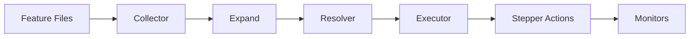

# Haibun Architecture: The Journey of a Feature Line

This document explains how Haibun processes feature files, grounded in a practical example: logging into a site, verifying all requests stay within allowed domains, and checking that the requests don't return 4xx/5xx or take longer than 5 seconds.

The following concepts will be introduced: actuality, phases, steppers, domains, observations, quantifiers, activities, waypoints and proofs, and monitors.

## Design Philosophy

Haibun offers value by extending behavior-driven development with literary programming and simple logic approaches. The same plain language feature file serves three purposes:
1. Define expected behavior
2. Verify systems match that specification
3. Explain the system to readers with up-to-date proof (screenshots, videos, network diagrams, etc)

The name comes from the Japanese literary form that combines prose and haiku. In Haibun:
- **Prose** (Sentence form) describes intent and context
- **Steps** (lowercase statements) are executable statements, like haiku interspersed in prose

This case sensitivity rule creates self-documenting tests where prose and steps are visually distinct.

**Actuality** is the live system and its results. The live system is the world (`TWorld`), its steppers and its step registry, from the Executor's first dispatched step until it ends. Its results are the record of each dispatched step, a `SeqPath` individual: the step's line, the stepper action it called, its status, its error where it failed, and when it started and ended. The messages a step logs and the products it returns are recorded against that individual. A feature states what is expected, and each of its steps passes or fails against actuality.

Much of actuality is outside a feature's control, such as the requests a page makes to third parties. Haibun includes first-order logic to provide a grounded and consistent way to reason about it (like ensuring every request in a trace meets a performance threshold) without the brittle complexity and error-prone loops of general-purpose programming.

## The Example Feature

```gherkin
Feature: Secure Login Verification

Backgrounds: site-setup ;; this defines variables, such as portal and credentials.
set of Allowed domains is ["example.com", "cdn.example.com", "api.example.com"]

Scenario: Login and verify domain compliance

    Activity: Log in
    go to the portal webpage
    input credentials for username
    input secret for password
    click "Sign In"
    wait for "Welcome"
    set Is logged in to true
    waypoint Is logged in with variable is logged in is true

    First log in using the waypoint.
    ensure Is logged in

    Now verify all requests stayed within allowed domains and performed well.
    
    every host observed in http-trace hosts is some domain in Allowed domains is matches {host} with "*{domain}"
    
    every request observed in http-trace is variable {request}/status is less than 400
    
    every request observed in http-trace is variable {request}/time is less than 5000
```

### Observability-Driven Verification

This example demonstrates observability-driven verification; validating constraints over runtime data that isn't directly controlled. The login steps are deterministic (classic BDD), but observations capture emergent behavior:

- Network requests: which hosts were contacted, response codes, latencies
- Accessibility violations: issues discovered in the rendered DOM
- Console messages: errors or warnings that surfaced during interaction

Domains define the constraint vocabulary. Quantifiers apply those constraints to observations:

```gherkin
set of Allowed domains is [...]           # Define what's valid  
every host observed in ... is some ...    # Assert all observations satisfy constraint
```

For example, to verify that console errors didn't occur:

```gherkin
set of Allowed levels is ["log", "info", "warn"]
every entry observed in console-log is variable {entry}/level is some level in Allowed levels
```

This pattern generalizes to other observation sources:

| Observation | Captures | Example Constraint |
|-------------|----------|-------------------|
| `http-trace` | Network requests | Statuses aren't 4xx/5xx, all hosts in allowlist |
| `http-headers` | Request/response headers | Valid auth tokens, security headers present |
| `console-log` | Browser messages | Entries aren't error-level |
| `page-performance` | Timing metrics | Largest contentful paint < 2500ms |
| Accessibility | WCAG violations | Serious = 0, moderate ≤ 3 |

These are examples of what can be built by combining observation sources, domain constraints, and first-order logic with the same core tested syntax.

Compare this to traditional BDD "then" statements for the same verification:

```gherkin
Then the request to "example.com/api/login" returned status 200
And the request to "cdn.example.com/styles.css" returned status 200  
And the request to "api.example.com/user" returned status 200
And no requests were made to "tracking.adnetwork.com"
And the login request completed in under 5000ms
And the dashboard request completed in under 5000ms
```

The observation pattern replaces these with a constraint over all captured data, which can be inspected using logging levels:

```gherkin
every request observed in http-trace is variable {request}/status is less than 400
```

# Phases

Haibun provides a core system that provides the following phases. The core has hundreds of unit tests and dozens of comprehensive end to end tests.



## Phase 1: Collector

Reads files from `features/` and `backgrounds/` directories (main features are strictly from `features/`,  arbitrary subfolders can be used in both cases for organizing). The following formats are supported:

- `.feature`: Plain text BDD
- `.feature.ts`: TypeScript "kireji" (converted to BDD via `toBdd()`)

## Phase 2: Expand

`Backgrounds: site-setup` is expanded inline; the referenced background file's content is merged at that position.

## Phase 3: Resolver

Resolution matches each line to a stepper action, building the complete execution plan before any steps run.

### Stop Word Stripping

`dePolite()` strips words from the start of a line:
```
^((given|when|then|and|should|the|it|I'm|I|am|an|a) )*
```

### Pattern Matching

For `go to the https://example.com/login webpage`:
- Pattern: `go to the { name } webpage`
- Captures: `{name}` = portal's value `https://example.com/login`

For `every request observed in http-trace is variable {request}/status is less than 400`:
- Pattern: LogicStepper's universal quantifier (see Logic System below)
- Parses: iteration source (`http-trace`), bound variable (`{request}`), nested statement

### Waypoint Resolution

Waypoints are registered during resolution. When the resolver encounters an `Activity:` block, it collects the steps before `waypoint` statements as the activity body, then generates a dynamic step that matches the corresponding `ensure` call with a proof, or a statement call without a proof.

## Phase 4: Executor

The Executor runs resolved features through stepper lifecycle methods. Actuality starts here: from this phase on there is a live system, and each step it performs adds to its results. Steppers that implement `IStepperCycles` can hook into execution at various points:

```
startExecution(features)     
  startFeature(feature)      
    startScenario(scopedVars)
      beforeStep(step)       
      [ACTION]               
      afterStep(step, result)
    endScenario()
  endFeature()
endExecution(results)
```

Throughout execution, `onEvent(event)` is called for each lifecycle event, log, or artifact. Monitors use this to observe and record execution.

For example, when `click "Sign In"` executes:
1. `beforeStep` debugger can pause here
4. `onEvent` broadcasts the step start to monitors
2. WebPlaywright's `click` step action runs
3. `afterStep` monitors record the result, `after every` hooks run
4. `onEvent` broadcasts the step completion to monitors

## Logic System

Haibun includes logical constructs for expressing verification rules declaratively. It uses first order logic to reason about objects and their relationships using values from any step.

### Negation

`not statement` inverts the result:
```
not variable status is "Error"
```

### Conditionals

`where condition, action` and `unless condition, action`:
```
where variable env is "staging", set debug to "true"
```

### Quantifiers

Quantifiers check **collections** of data without writing loops:

- `every x in domain is statement`: Universal quantifier (∀). Passes if statement succeeds for all values.
- `some x in domain is statement`: Existential quantifier (∃). Passes if statement succeeds for at least one value.

The bound variable `{x}` is available within the nested statement. From the example:
```
every request observed in http-trace is variable {request}/status is less than 400
```

This reads: "for every request captured in http-trace, verify that its status is less than 400."

Quantifiers, like other Haibun steps, are compasable. The nested form `every
... is some ... is ...` expresses "for all X, there exists Y such that
predicate(X, Y)":
```
every host observed in http-trace hosts is some domain in Allowed domains is matches {host} with "*{domain}"
```

## Domains

Domains are **safeguards**. They define exactly what values are allowed, preventing typos and invalid data from breaking tests. Often useful for observations.

```gherkin
set of Allowed hosts is ["example.com", "cdn.example.com", "api.example.com"]
set of Log levels is ["log", "info", "warn"]

not set endpoint as Allowed hosts to "tracking.adnetwork.com"  ;; would fail
not set severity as Log levels to "error"  ;; would fail
not set response as json to {woops  ;; would fail: malformed json
```

Ordered domains enable comparisons and state transitions, often useful for waypoints. 
```
ordered set of Request status is ["pending", "loading", "complete", "error"]
set api_state as Request status to "pending"
increment api_state
variable api_state is "loading"
variable api_state is less than "complete"
```

## Activities and Waypoints

Activities implement idempotent, goal-oriented testing. A waypoint's proof is an arbitrary statement that resolves to true or false, like every statement in Haibun. 

1. `ensure Outcome` first checks the proof (P)
2. If proof passes, skip the activity (efficiency)
3. If proof fails, run the activity (A), then re-check the proof

```gherkin
Activity: User is logged in
go to the login webpage
input credentials for username
click "Sign In"
set Logged in to true
waypoint User authenticated with variable Logged in is true

ensure User authenticated  ;; skips activity if already logged in
```

Waypoints can be parameterized:
```
waypoint Navigate to {page} with variable WebPlaywright.currentURI is {page}

ensure Navigate to mainUrl
ensure Navigate to haibunUrl
```


## Steppers

### Core Steppers

| Stepper | Example Steps |
|---------|---------------|
| Haibun | `Backgrounds: name`, `Feature:`, `Scenario:`, `until statement within duration`, `after every StepperName, statement` |
| VariablesStepper | `set var to "value"`, `variable var is "value"`, `set of domain is [values]`, `matches {var} with "pattern"`, `increment var` |
| ActivitiesStepper | `Activity: name`, `waypoint Label with proof`, `ensure outcome` |
| LogicStepper | `not statement`, `where condition, action`, `every x in domain is statement`, `some x in domain is statement` |
| DebuggerStepper | `debug step by step`, `debug stepper StepperName`, `continue stepper StepperName`; debugger commands: `step`, `continue`, `retry`, `next`, `fail` |

### Web Steppers

| Stepper | Example Steps |
|---------|---------------|
| WebPlaywright | `go to the {uri} webpage`, `click "{target}"`, `click "{target}" by "placeholder"`, `input {what} for {field}`, `wait for "{target}"`, `see "{text}"`, `cookie {name} is {value}`, `take a screenshot` |
| WebServerStepper | `serve files at /path from "dir"` |
| A11yStepper | `page is accessible accepting serious {N} and moderate {N}` |
| WebHttp | `fetch from {url} is "{expected}"` |

### Storage Steppers

| Stepper | Purpose |
|---------|---------|
| StorageFS | File system artifact storage |
| StorageMem | In-memory storage for tests |

## Observations

Observation sources provide runtime metrics for quantifier iteration via `observed in`:

| Source | Items | Provider |
|--------|-------|----------|
| `step usage` | Step names executed | Core |
| `stepper usage` | Stepper names active | Core |
| `http-trace` | HTTP request IDs | WebPlaywright |
| `http-trace hosts` | Hostnames contacted | Core (shared) |
| `visited pages` | URLs navigated | WebPlaywright |

Steppers register sources via `getConcerns()` in their cycles.

## Monitors

Monitors receive `THaibunEvent` via `onEvent` during execution. They track progress, emit telemetry, and generate reports.

| Monitor | Purpose |
|---------|---------|
| MonitorOtelStepper | OpenTelemetry traces to OTLP backends. Features become root spans; steps become child spans. |
| ConsoleMonitorStepper | Simple console output. |
| MonitorTuiStepper | Terminal UI showing live progress. |

## Variable Resolution

`FeatureVariables.resolveVariable()` resolves values based on origin. A parameter of a written domain (`statement`, `variable-name`, `domain-name`) takes the term the line writes, whatever its origin: `set x to 1` names the variable x, and never reads a variable called x. A variable's name has each `{name}` in it filled, so `set {who} greeted to "yes"` names a variable after the value of `who`.

For `Origin.defined` (the common case for unquoted variable references):

1. runtimeArgs: Check `featureStep.runtimeArgs[term]` (bound by quantifiers like `every x in`)
2. Environment: Check `world.options.envVariables[term]`
3. Stored variables: the variable of that full name, then a dot path into a variable that holds fields
4. Domain value: If the parameter's domain lists values (an enum) and the term is one of them, the term is that value, so `click "username" by placeholder` and `make an HTTP GET to ...` don't need quotes. A variable of the same name still wins
5. Otherwise the term is refused, and the message states to quote it to pass it as a literal. A dot path that names a field its variable doesn't have is refused with the fields the variable has

A number, JSON, and a length of time for a duration parameter (`pause for 30 s`) are literals as the line writes them.

For `Origin.quoted` (quoted strings like `"literal value"`):
- If `{varName}` syntax inside quotes, resolve via runtimeArgs → stored
- Otherwise, strip quotes and use as literal

For `Origin.var`: Direct lookup in stored values

For `Origin.env`: Direct lookup in environment variables

## TypeScript Features (Kireji)

For `.feature.ts` files, type-safe helpers generate BDD statements that support libraries:

```typescript
import { withAction } from '@haibun/core/kireji/withAction.js';
import type { TKirejiExport } from '@haibun/core/kireji/withAction.js';
import VariablesStepper from '@haibun/core/steps/variables-stepper.js';
import ActivitiesStepper from '@haibun/core/steps/activities-stepper.js';

const { set, compose } = withAction(new VariablesStepper());
const { activity, ensure } = withAction(new ActivitiesStepper());

export const backgrounds: TKirejiExport = {
    'Login setup': [
        activity({ activity: 'Setup credentials' }),
        set({ what: 'baseUrl', value: 'https://example.com' }),
        compose({ what: 'loginUrl', template: '{baseUrl}/login' }),
        'waypoint Credentials ready with variable baseUrl exists',
    ]
};

export const features: TKirejiExport = {
    'Login verification': [
        ensure({ outcome: 'Credentials ready' }),
        'go to the {loginUrl} webpage',  // Raw strings passed through
        'click "Sign In"',
    ]
};
```

## Extension Points

| Extension | How |
|-----------|-----|
| New Steppers | Extend `AStepper`, define `steps` object with `gwta`/`match`/`exact` patterns |
| Lifecycle Hooks | Implement `IStepperCycles` (`startFeature`, `afterStep`, `onEvent`, etc.) |
| Domains | Declare `TDomainDefinition` in the cycles' `getConcerns`: a schema that takes each form of the value and yields it |
| Observation Sources | Implement `IObservationSource` for quantifier iteration (`observed in source`) |
| Monitors | Implement `onEvent` to receive execution telemetry |

# How code is organized

Steppers, cycles and domains are how code extends haibun. Inside a module, each file holds one kind of code from the
table below, and each kind depends only on the kinds that "Kinds" allows it. A test reads each file's imports and fails
where a file depends on a kind it isn't allowed, so a function that mixes kinds fails where it is written.

## Areas

An area is a directory that holds the code of one concern: a store, a transport, a conversation with a model, a family
of views. Its files are of the kinds below, one kind per file, and the area's composition root in `root.ts` builds its
ports for the steppers that use them. An area that depends on another area is a subdirectory of that area's directory.
Its steppers and controllers import the composition root of each enclosing area.

## Kinds

Each kind except the stepper depends on its own kind and on the kinds its row lists. A stepper calls another stepper's
steps through `dispatchStep`, so a stepper doesn't import another stepper. A stepper imports domains because it returns
them from `getConcerns` and names their keys in its step patterns.

| Kind | Holds | Depends on |
|------|-------|------------|
| Domain | A declaration: a schema and its topology, given through `getConcerns` | core types |
| Derivation | A pure function from declarations: a read surface, a title, the concern catalog | domains, derivations |
| Machine | Statuses that events move: one state type, one event type, one pure transition and one table test | domains |
| Pipeline | One operation as pure steps over ports | domains, derivations, machines, ports |
| Port | An interface a pipeline reads or writes through: a store, an endpoint, a mailbox, a clock. An area's `ports.ts` holds only port types | types |
| Adapter | I/O through a database driver, HTTP, a mail server, a model endpoint, a browser or the filesystem. An adapter implements a port, raises a machine's events and returns data. It doesn't hold policy | ports, libraries |
| Composition root | The function in an area's `root.ts` that builds the area's ports from its adapters, and the area's machine instances from its machines, for the steppers and controllers that use them | ports, adapters, machines |
| Stepper | Steps that parse their input by domain, call one pipeline or send one machine event, and return products or a refusal. Its cycles connect lifecycle events to the same pipelines and machines | domains, pipelines, machines, the composition root of its area or of an enclosing area |
| Controller | A Lit `ReactiveController` a view holds. It reads the catalog's derivations and a machine's status, calls one pipeline or sends one machine event, and requests its host's update | domains, derivations, machines, pipelines, the composition root of its area or of an enclosing area |
| View | A `ShuElement` that renders from the concern catalog and machine statuses, through controllers. A view imports another view | controllers, domains, derivations |

## One flow

1. Every request enters through `dispatchStep`: a feature line, an RPC call, an MCP call, a model's tool call and a
   page's call. The dispatcher applies the gate, validates the input and writes the step's record.
2. The step calls one pipeline or sends one machine event.
3. The pipeline reads and writes through ports, and adapters perform the I/O.
4. The step returns products in a declared domain, or a refusal that states its cause and its remedy as a control.
5. The record, its facts and its events reach actuality.
6. Views render what actuality holds through the catalog and the machines' statuses.

## Rules

- Only an adapter imports a database driver, `fetch`, `node:fs`, a socket or a timer. A domain, a derivation, a machine
  and a pipeline don't perform I/O, and a pipeline reads the time through a clock port.
- Every read of records calls one read function. It bounds the page, states whether its count stopped at a ceiling,
  refuses what it can't reach, and states an order that gives each record one position.
- Everything a view shows has a declaration, including the named graphs actuality writes, so every node, row and link
  opens to a record that states what it is.
- A view doesn't name a type or a field: it reads both from the concern catalog.
- A refusal states its cause and carries its remedy as data, which a page renders as a control.
- A value that is absent is refused with a message that names what is missing and what supplies it, or its type states it
  as optional and the code reads its absence by name. Code doesn't replace an absent value with a default: a constant
  after `??` or `||`, a parameter's or a destructured initializer, a schema's `.default()`, or a compose variable's
  `${VAR:-value}`. A caller without a read action doesn't hold a read level, and a read, a write or an event without a level
  is refused.
